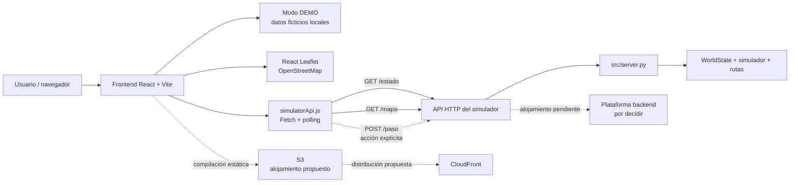

# Mordida Manta

Motor de simulación para **Escape de Manta Zombie (Track A)**. El proyecto
modela un mapa como grafo, mueve zombies por turnos, registra eventos de ciudad,
detecta mordidas y expone el estado del mundo para un simulador o un panel web.

> **Estado actual:** MVP local con simulador y motor de rutas integrados. El
> frontend incluye una red vial de OpenStreetMap para Manta; el grafo de 25
> nodos se conserva como fixture de pruebas del motor.
> La región de AWS está pendiente de confirmación; `us-east-1` es una opción
> inicial por validar, no una configuración desplegada.

## Arquitectura actual

```text
Cliente / simulador / frontend
              |
              | HTTP + x-api-key
              v
        src/server.py
              |
              v
        src/service.py
          /           \
         v             v
  ApocalypseSimulator  A* routing
  src/simulator.py     src/routing.py
         |
         v
      WorldState
      src/model.py
         |
         v
      CityGraph
      src/graph.py
```

El servidor usa un reloj interno que avanza un turno cada 2 segundos. El estado
vive en memoria durante esta primera versión; al reiniciar el proceso se
restaura el escenario inicial.

## Arquitectura del sistema

Mordida Mantense está organizada en dos partes principales: el motor de
simulación en Python y un frontend web independiente. El frontend presenta el
estado del mundo, pero no reemplaza las reglas del simulador ni ejecuta
automáticamente movimientos para todos los sobrevivientes.

### Componentes

- **Motor y API del simulador (`src/`) — implementado localmente.** `server.py`
  expone la API HTTP; `service.py` coordina el estado, el grafo, el simulador y
  el planificador; `model.py`, `graph.py`, `simulator.py` y `routing.py`
  contienen las entidades y reglas del mundo.
- **Frontend React + Vite (`frontend/`) — implementado localmente.** La
  aplicación se inicia con Vite y está compuesta por paneles de estado,
  estadísticas, eventos, rutas, controles y el mapa. El modo DEMO permite
  presentar la interfaz sin depender del backend.
- **Mapa Leaflet + OpenStreetMap — implementado en el frontend.**
  `MantaMap.jsx` usa React Leaflet para dibujar nodos, calles, rutas, calles
  bloqueadas, sobrevivientes, zombies y refugios. Las posiciones DEMO están
  identificadas como ficticias.
- **Conexión con la API (`frontend/src/services/simulatorApi.js`) —
  preparada.** El módulo consulta `GET /estado` y `GET /mapa`, valida la
  información que actualmente publica este repositorio y deja disponible
  `POST /paso` para una solicitud explícita de siguiente nodo. El hook
  `useWorldState.js` realiza polling configurable, evita solicitudes
  simultáneas y conserva el último estado válido si la API falla.
- **Endpoints del simulador — implementados en el backend local.**
  `GET /estado` devuelve el estado público del mundo y `POST /paso` recibe
  `sobrevivienteId`, `nodoActual` y `turno` para devolver `siguienteNodo`.
  El frontend no invoca `POST /paso` masivamente; la estrategia de quién
  solicita y confirma movimientos debe acordarse con el equipo del simulador.
- **Alojamiento web en Amazon S3 y CloudFront — propuesto, no desplegado.**
  El frontend Vite puede compilarse a `frontend/dist` y alojarse como sitio
  estático en S3, opcionalmente distribuido mediante CloudFront. Todavía no
  existe un bucket, una distribución ni una URL de despliegue documentada.
- **Alojamiento del backend — pendiente de decisión.** El backend funciona
  actualmente como servidor local. Aún debe decidirse si se desplegará en una
  instancia, un servicio de contenedores, una función u otra arquitectura.
  Este README no asume una plataforma ni un endpoint público.

### Guía rápida para el equipo

- **Backend:** desde la raíz, ejecuta `python -m src.server`. Define
  `MANTA_API_KEY` si usarás rutas protegidas. El mapa viene de `GET /mapa` y
  el estado de `GET /estado`.
- **Frontend:** en otra terminal ejecuta `cd frontend`, `npm install` y
  `npm run dev`. Para conectar al servidor local configura
  `VITE_API_BASE_URL=http://localhost:8080` en `frontend/.env`; los detalles
  de DEMO, API y despliegue están en `frontend/README.md`.
- **Calles bloqueadas en API REAL:** `GET /estado` debe incluir
  `aristasBloqueadas` con pares de IDs de nodos, por ejemplo `[["A", "B"]]`.
  El mapa vincula cada par con la geometría de `GET /mapa`, aunque los IDs
  lleguen invertidos. La capa **Calles bloqueadas** muestra una línea naranja
  discontinua y una barrera. Si falta, comprueba que ambos endpoints usen los
  mismos IDs y que `/estado` publique el bloqueo.
- **Colaboración:** los cambios del motor y API van en `src/`; los de interfaz
  y mapa en `frontend/src/`. No publiques secretos ni los incluyas en variables
  `VITE_*`.

### Diagrama de arquitectura



### Estado de implementación

| Capacidad | Estado | Nota |
|---|---|---|
| Motor de simulación y reglas del mundo | Implementado localmente | Vive en `src/` y mantiene el estado en memoria. |
| API `GET /estado`, `GET /mapa` y `POST /paso` | Implementada localmente | Requiere `x-api-key` en el servidor actual. |
| Dashboard React + Vite | Implementado localmente | Incluye modo DEMO y modo API. |
| Mapa interactivo | Implementado localmente | Usa React Leaflet y tiles de OpenStreetMap. |
| Adaptador frontend de API | Preparado para integración | Lee variables `VITE_*`, valida respuestas y gestiona errores. |
| WebSocket | Pendiente | El backend actual no publica un contrato WebSocket. |
| S3 y CloudFront | Propuesto | Falta configurar y validar el despliegue. |
| Alojamiento público del backend | Pendiente | La plataforma y la URL todavía no están definidas. |

### Seguridad y configuración

- No se deben publicar claves privadas ni credenciales de AWS en el frontend.
- Las variables `VITE_*` son configuración que termina expuesta en el bundle;
  por eso solo deben contener valores públicos, como una URL de API o un
  intervalo de polling.
- El servidor actual protege los endpoints privados con `x-api-key`; en un
  despliegue real deberán definirse autenticación, autorización, CORS y
  gestión segura de secretos en la capa del backend o gateway.
- El navegador no debe asumir que DEMO equivale a una conexión real. La
  interfaz mantiene estados separados para DEMO, API conectada y API
  desconectada.

### Presupuesto inicial de seguimiento

El equipo usará **10 USD mensuales** como objetivo inicial de seguimiento para
la conversación de infraestructura AWS. Este valor no es un límite de gasto,
no constituye una estimación final y no confirma que exista un despliegue.
Antes de habilitar servicios deberán revisarse los precios, regiones, uso
esperado, alertas y controles de presupuesto de la cuenta.

## Estimación de costes y plan de despliegue

Esta sección describe candidatos y etapas de trabajo para la responsabilidad
de AWS. **No hay servicios AWS desplegados ni compras realizadas desde este
repositorio.** Los costes están **pendientes de calcular en [AWS Pricing
Calculator](https://calculator.aws/)**; dependen de la región, configuración,
tráfico, almacenamiento, solicitudes, tiempo de ejecución y tiempo activo.

### Servicios candidatos

| Servicio o tecnología | Función prevista | ¿Necesario para la primera demostración? | Factores que pueden generar costes | Estado actual |
|---|---|---|---|---|
| Amazon S3 + CloudFront | Alojar y distribuir los archivos estáticos generados por Vite (`frontend/dist`). | S3 puede ser suficiente para una primera publicación; CloudFront es opcional para la demostración inicial. | Almacenamiento en S3, solicitudes, transferencia de datos, distribución y solicitudes de CloudFront. **Pendiente de calcular en AWS Pricing Calculator.** | Propuesto; no hay bucket ni distribución creados. |
| AWS Lambda + API Gateway | Alternativa para alojar la API si el backend se adapta a funciones y al contrato HTTP requerido. | No; la primera demostración puede ejecutarse en local con DEMO. | Invocaciones, duración y memoria de Lambda; solicitudes, transferencia y configuración de API Gateway. **Pendiente de calcular en AWS Pricing Calculator.** | Alternativa pendiente de decisión; no desplegado. |
| Amazon DynamoDB | Persistir estados, eventos o configuraciones si el backend deja de usar memoria y necesita almacenamiento durable. | No para la primera demostración local. | Capacidad o solicitudes de lectura/escritura, almacenamiento, recuperación y transferencia. **Pendiente de calcular en AWS Pricing Calculator.** | Condicional; no desplegado. |
| Amazon CloudWatch | Centralizar registros, métricas y alarmas del backend y de los servicios desplegados. | No para DEMO local; recomendable antes de una prueba desplegada. | Volumen de logs ingeridos y almacenados, métricas personalizadas, consultas y alarmas. **Pendiente de calcular en AWS Pricing Calculator.** | Propuesto; no configurado. |
| AWS Budgets | Crear alertas de seguimiento de costes y revisar el consumo de la cuenta. | No es necesario para ejecutar la DEMO, pero debe configurarse antes de habilitar recursos AWS. | La configuración de alertas no sustituye el control de uso; los costes derivan de los servicios consumidos. **Pendiente de calcular en AWS Pricing Calculator.** | Objetivo de alerta documentado; no se confirma una alerta activa en una cuenta. |
| Leaflet + OpenStreetMap | Mostrar el mapa interactivo en el navegador; no es un servicio AWS. | Sí, para la experiencia visual del mapa. | Leaflet no implica un servicio AWS; el uso de los tiles de OpenStreetMap está sujeto a sus políticas, atribución, capacidad y límites del proveedor. | Implementado en el frontend; no es un recurso AWS. |

### Presupuesto de seguimiento

Se registra como objetivo de seguimiento un presupuesto de **10 USD
mensuales** para documentarlo en **AWS Budgets** cuando el equipo configure la
cuenta. Es una **alerta de seguimiento, no un límite de gasto garantizado**:
AWS no detendrá automáticamente todos los recursos al alcanzar esa cifra.
Tampoco es una estimación final del coste ni confirma que AWS Budgets esté
activo actualmente. Antes de crear recursos, una persona con acceso a la
cuenta debe configurar la alerta, destinatarios y periodo de evaluación.

### Plan de despliegue por etapas

1. **Etapa 1: frontend local en modo DEMO.** Ejecutar React/Vite, verificar el
   mapa, los indicadores y los eventos con datos ficticios claramente
   identificados.
2. **Etapa 2: validación de endpoints.** Revisar con la persona responsable del
   backend el contrato y autenticación de `GET /estado`, `GET /mapa` y
   `POST /paso`, incluyendo CORS, nombres de campos, coordenadas y estrategia
   de solicitudes.
3. **Etapa 3: publicación del frontend en AWS.** Generar `frontend/dist`,
   configurar S3 y, si se aprueba, CloudFront. Validar rutas, HTTPS, caché y
   variables públicas de build. Esta etapa todavía no se ha ejecutado.
4. **Etapa 4: conexión con la API desplegada.** Configurar la URL acordada en
   `VITE_API_BASE_URL`, probar el modo API, errores, timeout, polling y
   autenticación sin incluir secretos en el bundle.
5. **Etapa 5: pruebas de carga, latencia y supervivencia.** Ejecutar las
   pruebas acordadas con los escenarios del hackathon (20, 80 y 200
   sobrevivientes), medir resultados reales y observar el comportamiento del
   backend y del frontend.
6. **Etapa 6: revisión de costes y limpieza.** Revisar consumo y logs,
   comparar con AWS Pricing Calculator, confirmar la alerta de AWS Budgets y
   eliminar recursos temporales que ya no se necesiten.

### Lista de verificación

#### Antes del despliegue

- [ ] Confirmar la cuenta, región y responsable de AWS.
- [ ] Calcular escenarios de uso en [AWS Pricing
      Calculator](https://calculator.aws/).
- [ ] Configurar la alerta de seguimiento de 10 USD mensuales en AWS Budgets.
- [ ] Confirmar el contrato, autenticación y CORS de la API.
- [ ] Validar `VITE_API_BASE_URL` sin incluir claves privadas.
- [ ] Ejecutar `npm run build` y revisar `frontend/dist`.
- [ ] Comprobar el modo DEMO y la indicación de datos simulados.
- [ ] Definir política de tiles, atribución y uso de OpenStreetMap.
- [ ] Acordar cómo se observarán logs, errores y latencia.

#### Después del despliegue

- [ ] Confirmar que el frontend publicado carga por HTTPS.
- [ ] Verificar que S3 y CloudFront sirven la versión esperada.
- [ ] Probar la API desde el frontend con datos reales autorizados.
- [ ] Confirmar que el estado DESCONECTADO conserva el último estado válido.
- [ ] Revisar logs, errores, latencia y consumo observado.
- [ ] Ejecutar los escenarios de carga acordados sin modificar las reglas del
      simulador.
- [ ] Revisar el presupuesto y sus notificaciones.
- [ ] Eliminar buckets, distribuciones, funciones, tablas, logs u otros
      recursos temporales que ya no sean necesarios.

## Requisitos

- Python 3.10 o superior.
- No se necesitan dependencias externas para ejecutar el MVP.
- `MANTA_HORDE_RADIUS` configura el radio peligroso de las hordas en saltos
  (por defecto `1`; use `0` para marcar solo el nodo de la horda).
- `MANTA_CORS_ORIGIN` establece el origen permitido por CORS (por defecto `*`;
  en despliegue se recomienda el dominio del frontend).

## Instalación y ejecución

Desde la raíz del repositorio:

```powershell
$env:MANTA_API_KEY = "clave-local"
$env:MANTA_RANDOM_SEED = "42"
python -m src.server
```

El servidor queda disponible en:

```text
http://localhost:8080
```

El proceso avanza automáticamente un turno cada 2 segundos. Para detenerlo:

```text
Ctrl + C
```

## API

Las rutas protegidas requieren la cabecera; `/`, `/mapa` y `/salud` son
públicas. Use:

```text
x-api-key: clave-local
```

### `GET /`

Muestra las rutas disponibles:

```powershell
curl.exe http://localhost:8080/
```

### `GET /estado`

Devuelve el estado completo del mundo:

```powershell
curl.exe -H "x-api-key: clave-local" `
  http://localhost:8080/estado
```

Incluye:

- Turno actual.
- Zombies, tipo, nodo y visibilidad.
- Sobrevivientes, nodo actual, nodo anterior y estado activo.
- Refugios.
- Calles bloqueadas.
- Eventos ocurridos.
- Eventos programados.
- Coordenadas de los nodos.
- Rutas planificadas completas, con nombres de nodos y calles.

### `POST /paso`

Recibe una petición de ruta y devuelve únicamente el siguiente nodo:

```powershell
$headers = @{ "x-api-key" = "clave-local" }
$body = @{
    sobrevivienteId = "S-0001"
    nodoActual = "N-0013"
    turno = 1
} | ConvertTo-Json

Invoke-RestMethod -Method Post `
  -Uri "http://localhost:8080/paso" `
  -Headers $headers `
  -ContentType "application/json" `
  -Body $body | ConvertTo-Json
```

Respuesta:

```json
{
  "siguienteNodo": "N-0012"
}
```

El resultado siempre debe ser un vecino por una calle abierta o el mismo nodo.

### `POST /mover-sobreviviente`

Confirma el movimiento que efectivamente realizó un sobreviviente. Este
endpoint permite guardar `nodoAnterior` y detectar cruces con zombies:

```powershell
$body = @{
    sobrevivienteId = "S-0001"
    nodoDestino = "N-0014"
} | ConvertTo-Json

Invoke-RestMethod -Method Post `
  -Uri "http://localhost:8080/mover-sobreviviente" `
  -Headers $headers `
  -ContentType "application/json" `
  -Body $body | ConvertTo-Json
```

Devuelve `movido: false` si el destino no es vecino, la calle está bloqueada o
el sobreviviente ya fue eliminado.

### `POST /simular-turno`

Avanza manualmente exactamente un turno. Es útil para pruebas; el servidor ya
lo ejecuta automáticamente cada 2 segundos.

```powershell
Invoke-RestMethod -Method Post `
  -Uri "http://localhost:8080/simular-turno" `
  -Headers $headers `
  -ContentType "application/json" `
  -Body '{}'
```

También permite simular un cierre de calle:

```powershell
$body = @{
    aristaBloqueada = @("N-0013", "N-0014")
} | ConvertTo-Json

Invoke-RestMethod -Method Post `
  -Uri "http://localhost:8080/simular-turno" `
  -Headers $headers `
  -ContentType "application/json" `
  -Body $body | ConvertTo-Json
```

El cierre solo se registra si esa conexión existe en el grafo cargado. Las
rondas cargan sus eventos al llamar `POST /escenario`: `ronda2` intenta cerrar
su calle programada en el turno 10; `ronda3` intenta cerrar las suyas en los
turnos 10 y 20. Esos IDs de ejemplo pertenecen al mapa demo de 25 nodos. Si se
usa otro mapa, hay que configurar las aristas de evento con IDs de ese mapa;
el backend ahora registra un error y no declara aplicado un cierre inexistente.
En el estado inicial sin escenario no se programan cierres.

### `POST /escenario`

Carga uno de los escenarios de la prueba de fuego:

| Escenario | Sobrevivientes | Amenazas | Eventos |
|---|---:|---|---|
| `ronda1` | 20 | Caminantes | Ninguno |
| `ronda2` | 80 | Caminantes, corredores y hordas | Puente en turno 10 |
| `ronda3` | 200 | Todos los tipos, incluidos dormidos | Puente en turno 10 y avenida en turno 20 |

```powershell
$body = @{ escenario = "ronda3" } | ConvertTo-Json

Invoke-RestMethod -Method Post `
  -Uri "http://localhost:8080/escenario" `
  -Headers $headers `
  -ContentType "application/json" `
  -Body $body | ConvertTo-Json
```

### `GET /mapa`

Devuelve el mapa en un formato que puede consumir Leaflet u otro frontend:

```powershell
curl.exe http://localhost:8080/mapa
```

La respuesta contiene:

```json
{
  "nodos": [
    {"id": "N-0001", "lat": -0.95, "lng": -80.72}
  ],
  "calles": [
    {
      "origen": "N-0001",
      "destino": "N-0002",
      "distancia_m": 100,
      "tipo": "avenida"
    }
  ]
}
```

### `GET /ruta/{sobrevivienteId}`

Con `x-api-key`, devuelve la ruta completa segura, sus calles, distancia y
rutas alternativas. Si el refugio asignado está bloqueado por peligro, el
planificador elige el refugio alcanzable de menor distancia.

### `GET /salud`

Devuelve `{"estado":"ok","turno":...}` para comprobar que el backend
responde. No revela la API key.

La clave se mantiene exclusivamente en el backend. Un frontend desplegado no
debe incluir `MANTA_API_KEY`; para una aplicación pública se necesita un
backend intermediario o una estrategia de sesión antes de exponer rutas
protegidas directamente al navegador.

## Reglas implementadas

- **Caminante:** avanza una calle cada dos turnos.
- **Corredor:** avanza hasta dos calles por turno y persigue sobrevivientes a
  tres nodos o menos.
- **Horda:** permanece en su nodo; `MANTA_HORDE_RADIUS` configura cuántos
  saltos vecinos se consideran peligrosos (predeterminado: 1).
- **Dormido:** permanece invisible hasta que un sobreviviente se acerca a dos
  nodos o menos; entonces despierta como caminante.
- **Mordida:** ocurre si zombie y sobreviviente comparten nodo o se cruzan en
  direcciones opuestas por la misma calle.
- **Calle bloqueada:** se bloquea en ambos sentidos.
- **Eventos:** se aplican automáticamente en el turno programado.
- **Rutas:** A* ponderado por distancia de calle, con alternativas y
  caché invalidada por cambios de zombies y calles bloqueadas.
- **Cruce frontal:** el planificador evita una calle si el último movimiento
  visible de un zombie cruzó en sentido contrario.

## Pruebas

Ejecutar desde la raíz:

```powershell
python -m unittest discover -s tests -v
```

Ensayo de 200 solicitudes HTTP reales en un servidor local aislado:

```powershell
python scripts/load_test.py
```

El ensayo precalienta las cuatro combinaciones de refugio con el mismo origen
y reporta ese tiempo aparte. Luego mide 200 llamadas con ocho clientes
concurrentes. Ajuste la concurrencia con `MANTA_LOAD_WORKERS`. Imprime éxitos,
errores, latencia media, p95 y máxima en milisegundos.

La suite cubre:

- Movimiento de los tipos de zombie.
- Turnos automáticos.
- Activación de dormidos.
- Mordidas y cruces opuestos.
- Validación de movimientos.
- Bloqueos y eventos.
- Escenarios de 20, 80 y 200 sobrevivientes.
- Contrato de carga de mapas.
- Estado para el frontend.

## Mapa y datos

El frontend incluye `frontend/src/data/mantaRoadNetwork.json`, una red vial
local derivada de OpenStreetMap con 709 nodos y 2.232 calles con geometría.
El grafo pequeño de 25 nodos se mantiene como fixture de desarrollo y pruebas;
no es la red que dibuja el mapa actual. Consulte `frontend/README.md` y
`data/README.md` para los detalles del conjunto de datos.

Los IDs `N-0001` y `N-0002` son identificadores técnicos. El estado y el mapa
también exponen nombres legibles de intersecciones y calles, por ejemplo
`Intersección Av. 4 de Noviembre / Calle 1` y `Av. 4 de Noviembre 1`. Al cargar
datos reales, esos nombres deben venir de la exportación de OpenStreetMap.

La regla de horda es configurable con `MANTA_HORDE_RADIUS`.

El cargador disponible es:

```python
from src.graph import CityGraph

graph = CityGraph.from_dict(map_data)
```

## Integración con el integrante 2

Flujo recomendado por turno:

```text
1. El motor de rutas llama POST /paso.
2. Recibe siguienteNodo.
3. Confirma el movimiento mediante move_survivor().
4. El simulador conserva nodoAnterior y nodo actual.
5. Se detectan mordidas y cruces.
6. El frontend consulta GET /estado.
```

El servicio también expone directamente:

```python
service.move_survivor("S-0001", "N-0014")
```

## Estructura del proyecto

```text
README.Md
data/
  README.md
src/
  graph.py       # Grafo y carga/exportación del mapa
  model.py       # Entidades y estado del mundo
  routing.py     # Dijkstra, alternativas y seguridad de movimientos
  cache.py       # Caché LRU de rutas por estado de peligro
  scenarios.py   # Rondas 1, 2 y 3
  server.py      # API HTTP
  service.py     # Fachada del sistema
  simulator.py   # Reglas y turnos del apocalipsis
  turn_loop.py   # Reloj automático de 2 segundos
tests/
  test_routing.py
```

## Limitaciones actuales

- El motor conserva fixtures de 25 nodos para pruebas; el frontend usa la red
  vial local de Manta. La API debe entregar nodos y calles compatibles para
  reutilizar geometría real en modo API.
- El estado todavía no está persistido en DynamoDB o Redis.
- El backend todavía no está desplegado en AWS.
- No hay frontend Leaflet publicado en AWS.
- El código local de escenarios debe contrastarse con los números exactos de
  la prueba: `src/scenarios.py` crea actualmente 8 caminantes en Ronda 1, una
  cantidad menor a los 20 caminantes indicados por el Track A. El frontend no
  compensa esa diferencia con entidades inventadas.
- La API key es una variable de entorno local.
- La capacidad de refugios y la flota de rescate son funcionalidades PRO
  pendientes.

## Próximos pasos del equipo

1. Sustituir el grafo demo por datos reales validados de OpenStreetMap.
2. Construir el panel Leaflet y conectarlo a `/mapa`, `/estado` y `/ruta/{id}`.
3. Desplegar API, estado y frontend en AWS.
4. Agregar AWS Budget, CloudWatch, diagrama de arquitectura y declaración de
   costos.
